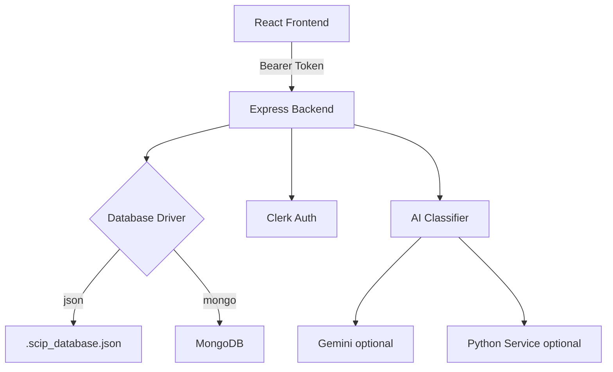

# Smart Community Intelligence Platform (SCIP)

A civic issue reporting and management platform with six role-based dashboards, AI-powered incident analysis, and comprehensive audit logging.

## Overview

SCIP is a full-stack application that enables citizens to report community issues, which are then analyzed by AI, assigned to officers, tracked through resolution, and verified by administrators. The platform supports six distinct roles with role-based access control.

## Features

- **Citizen reporting** with GPS location, image upload, and AI classification
- **AI analysis** using deterministic TypeScript classifier (optional Gemini/Python services)
- **Incident management** with officer assignment and status tracking
- **Geospatial intelligence** with Leaflet maps, hotspots, and clustering
- **Notification system** for lifecycle events
- **Audit logging** with tamper-evident hash chain
- **Image processing** with EXIF extraction and OCR (optional Python service)
- **Admin panel** with user management, backup/restore, and system monitoring

## Six User Roles

| Role | Dashboard | Capabilities |
|------|-----------|-------------|
| citizen | CitizenDashboard | Submit reports, track status, view notifications |
| field_officer | FieldOfficerDashboard | Assigned reports, inspections, status updates |
| dept_officer | DeptOfficerDashboard | Department reports, officer management, assignments |
| analyst | AnalystDashboard | Analytics, trends, exports, AI insights |
| authority | AuthorityDashboard | Oversight, department performance, escalations |
| admin | AdminPanelView | User management, RBAC, audit logs, backups |

## Technology Stack

**Frontend:** React 18, TypeScript, Vite 8, Tailwind CSS, Leaflet, Clerk React SDK

**Backend:** Node.js, Express, TypeScript, Mongoose (optional), Clerk Backend SDK

**Database:** JSON file-backed (default) or MongoDB (opt-in, isolated dev only)

**AI:** TypeScript deterministic classifier (always available), optional Gemini LLM, optional Python FastAPI service

**Testing:** Playwright (E2E), custom regression scripts (tsx), TypeScript typecheck

## Architecture



## Project Structure

```
src/
├── components/views/     (33 view components)
├── server/routes/        (15 route files)
├── database/             (scipDatabase, jsonRepository, mongoRepository)
├── ai/                   (18 AI modules)
├── services/             (apiClient, emailService)
├── context/              (AuthContext, ThemeContext, LanguageContext)
└── types/scip.ts
e2e/                      (Playwright tests)
scripts/                  (regression tests)
docs/                     (30+ verification reports)
```

## Installation

```bash
npm install
cd e2e && npm install
```

## Environment Configuration

Copy `.env.example` to `.env` and configure:

```bash
VITE_CLERK_PUBLISHABLE_KEY=pk_test_...
CLERK_SECRET_KEY=sk_test_...
CLERK_AUTHORIZED_PARTIES=http://localhost:3000
DATABASE_DRIVER=json
NODE_ENV=development
```

## Running Locally

```bash
# Backend + Frontend (dev server on port 3000)
npm run dev

# Typecheck
npm run typecheck

# Production build
npm run build
```

## Testing

```bash
# Frontend API client tests
npm run test:frontend

# Security tests
npm run test:security

# Submission regression
npx tsx scripts/phase32-submission-regression.mts

# Playwright E2E
cd e2e && npx playwright test

# Isolated DB smoke
NODE_ENV=test SCIP_TEST_DB_PATH=tmp/test.db npx tsx scripts/phase34-isolated-db-smoke.mts
```

## Database

- **Default:** JSON file-backed (`.scip_database.json`)
- **Optional:** MongoDB (requires `DATABASE_DRIVER=mongo` + `MONGODB_URI`)
- **Safety:** `.scip_database.json` is protected; isolated test DB via `SCIP_TEST_DB_PATH` in test mode
- **Backup:** `createBackup()` method available

## Security

- Clerk Bearer token authentication
- RBAC with 6 roles and permission matrix
- Rate limiting
- CSP headers
- Input validation (frontend + backend)
- Image magic-byte validation
- Image GET ownership authorization
- Audit log hash chain (tamper-evident)
- Session version invalidation

## AI Integration Status

| Service | Status |
|---------|--------|
| TypeScript classifier | ACTIVE (deterministic fallback) |
| Gemini LLM | NOT CONFIGURED (no API key) |
| Python AI service | NOT CONFIGURED (disabled by default) |

## Current Status

- **Automated tests:** 69 pass (7 frontend + 11 submission + 45 security + 6 E2E)
- **Typecheck:** PASS
- **Build:** PASS
- **Live Clerk auth:** BLOCKED (requires user interaction)
- **6-role dashboards:** UNVERIFIED (require live auth)
- **Production deployment:** NOT READY

## Known Limitations

1. Live Clerk authentication requires user to configure Clerk Dashboard
2. MongoDB Atlas requires user to set MONGODB_URI
3. No automated browser auth tests (no Playwright auth framework)
4. Sync persist blocks event loop (performance)
5. No production monitoring/logging service

## Documentation

See `docs/` for 40+ verification and audit reports covering all phases.

## License

MIT
EOF