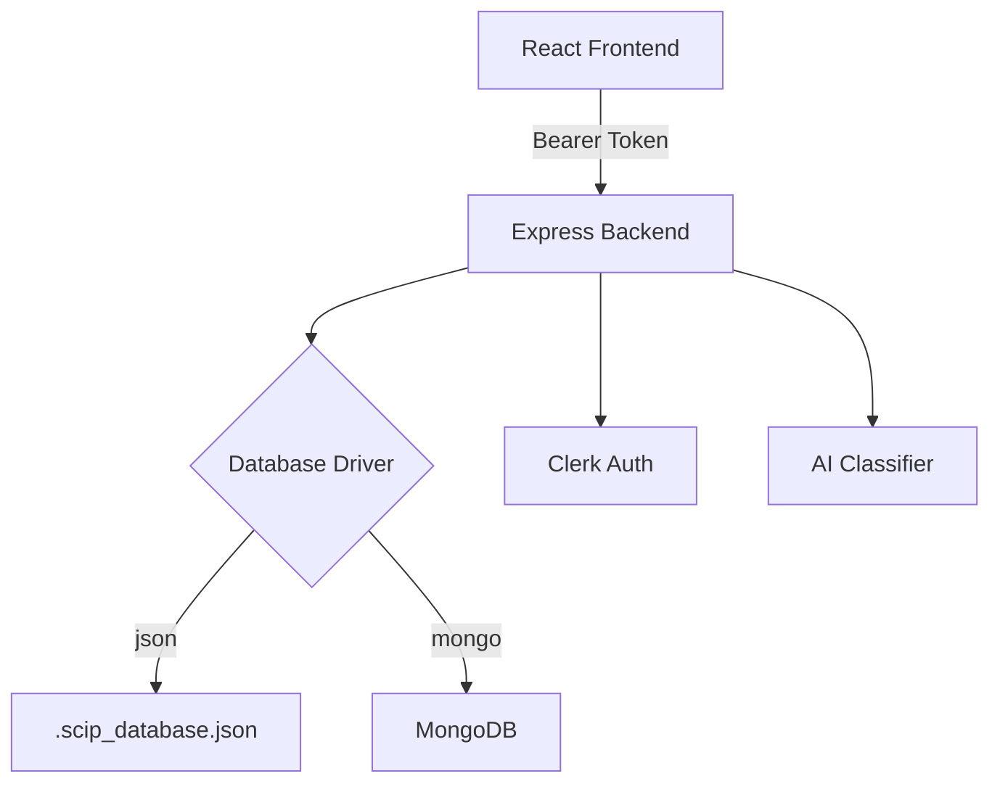

# SCIP System Architecture and Database Design

## System Overview
SCIP is a full-stack civic issue reporting platform with 6 role-based dashboards, AI-powered analysis, and comprehensive audit logging.

## Technology Stack
- Frontend: React 18, TypeScript, Vite 8, Tailwind CSS, Leaflet
- Backend: Node.js, Express, TypeScript
- Database: JSON file-backed (default) or MongoDB (opt-in)
- Auth: Clerk (Bearer token)
- AI: TypeScript deterministic classifier, optional Gemini/Python

## Architecture Diagram

## Database Entities
- User (id, email, role, status, etc.)
- Report (id, title, description, category, location, status, etc.)
- Incident (id, title, status, priority, etc.)
- Department (id, name, etc.)
- Notification (id, userId, type, read, etc.)
- AuditLog (id, action, module, userId, hash, prevHash)
- ImageMetadata (imageId, format, sizeBytes, etc.)

## Six Roles
- citizen, field_officer, dept_officer, analyst, authority, admin
- Permission matrix in auth.ts
- Backend authorization via requirePermission middleware

## Security
- Clerk Bearer token auth
- RBAC with 6 roles
- Rate limiting (300/15min unauth, 60/15min auth)
- CSP headers
- Upload validation (magic bytes)
- Image GET ownership check
- Audit log hash chain

## Database Architecture
- JSON: file-backed, sync persist, in-memory Maps
- MongoDB: opt-in, requires 5 env gates, not parity-verified
- Isolated test DB via SCIP_TEST_DB_PATH (test mode only)

## Known Limitations
- Live Clerk auth: BLOCKED (requires user)
- MongoDB Atlas: not configured (safety gates reject Atlas URIs in prod)
- 6-role dashboards: UNVERIFIED (require live auth)
- Sync persist blocks event loop
- No production monitoring

## Data Preservation
- .scip_database.json: never modified
- DB hash unchanged throughout all phases
EOF